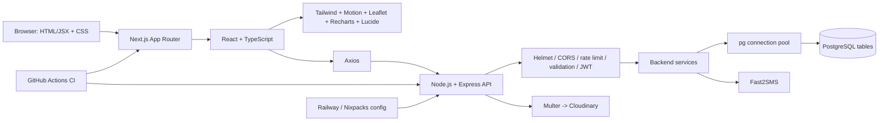
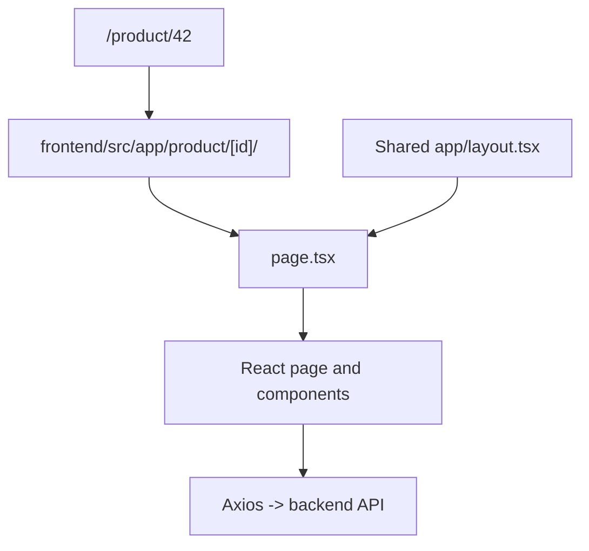
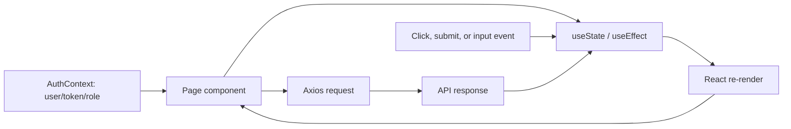
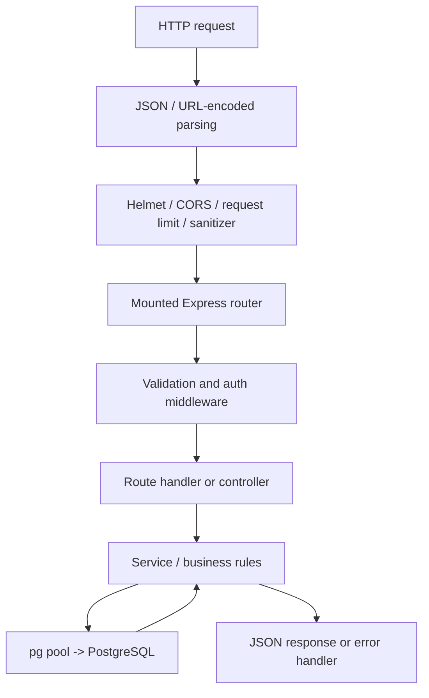
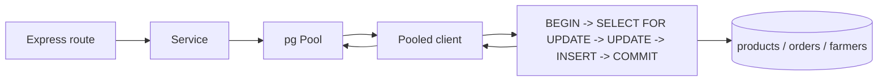
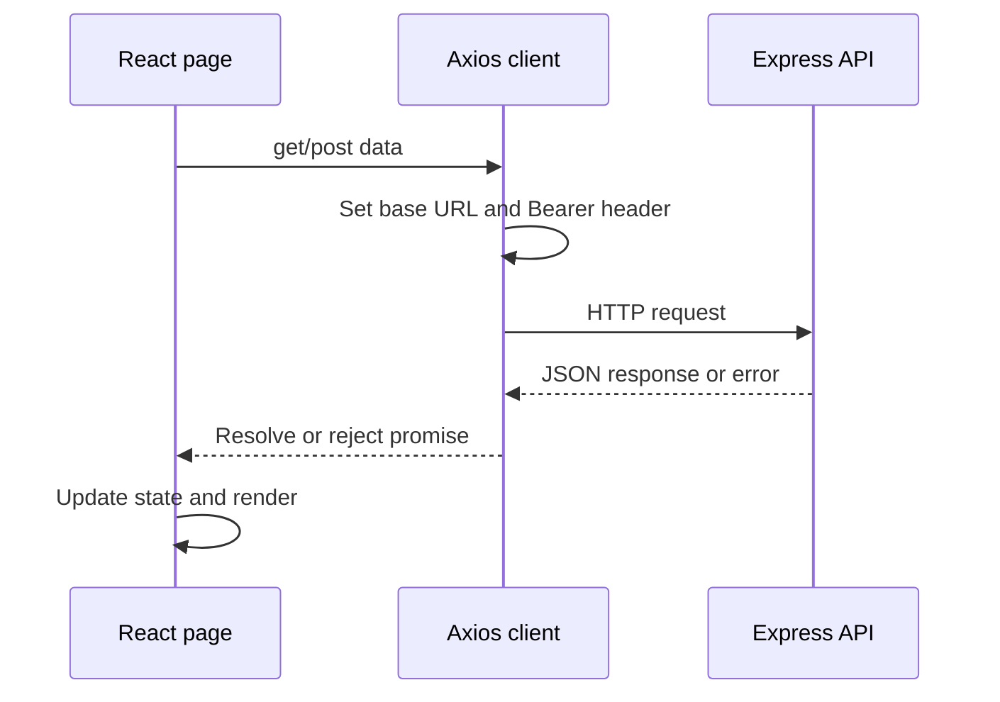
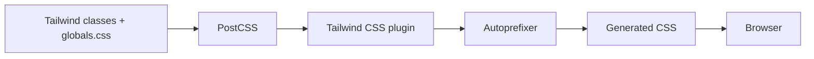

# Farm Connect Codebase Documentation

## 1. Project Overview

Farm Connect is a full-stack direct farmer-to-consumer marketplace.
The frontend discovers farmers and products.
The Express backend exposes REST APIs.
PostgreSQL stores users, locations, products, orders, reviews, wishlists, and notifications.

## 2. Repository Folders

| Folder | Purpose |
|---|---|
| `frontend/` | Active Next.js frontend. Routes, React components, contexts, hooks, API helpers, and frontend configuration live here. |
| `backend/` | Active Express backend. API entry point, route modules, controllers, middleware, services, and database configuration live here. |
| `database/` | PostgreSQL schema, seed data, migrations, and SQL utilities. |
| `docs/` | Architecture diagrams and generated documentation sources. |
| `src/` | Legacy root application prototype. It is retained for compatibility and is not the canonical backend. |
| `node_modules/`, `frontend/node_modules/`, `backend/node_modules/` | Installed dependencies. These folders should not be edited directly. |

Evidence:
- Frontend structure: `frontend/src/app/`, `frontend/src/components/`, `frontend/src/context/`, `frontend/src/lib/`
- Canonical backend entry point: `backend/src/app.js`
- Database schema: `database/schema.sql`
- Root entry point forwarding note: `server.js`
- Legacy prototype warning: `src/app.js`

## 3. Technology Stack

### Frontend

| Technology | Version or use | Declared in |
|---|---|---|
| Next.js | 16.2.4; App Router | `frontend/package.json` |
| React | 19.2.4 | `frontend/package.json` |
| TypeScript | 5.x; strict mode enabled | `frontend/package.json`, `frontend/tsconfig.json` |
| Tailwind CSS | 3.4.4; theme and dark mode | `frontend/package.json`, `frontend/tailwind.config.ts` |
| Axios | 1.15.0; HTTP client and interceptors | `frontend/package.json`, `frontend/src/lib/api-client.ts` |
| React Leaflet | 5.0.0; interactive maps | `frontend/package.json` |
| React Hook Form and Zod | Forms and validation | `frontend/package.json` |

Frontend routing uses Next.js App Router under `frontend/src/app/`.
The root layout and global providers are in `frontend/src/app/layout.tsx`.

### Backend

| Technology | Version or use | Declared in |
|---|---|---|
| Node.js | Server runtime | `backend/package.json` |
| Express | 4.19.2; REST API | `backend/package.json` |
| PostgreSQL `pg` | 8.11.5; connection pool | `backend/package.json`, `backend/src/config/database.js` |
| JWT | 9.0.3; authentication tokens | `backend/package.json` |
| bcrypt | 6.0.0; password hashes | `backend/package.json` |
| Cloudinary | 2.1.0; remote image storage | `backend/package.json` |
| Multer | 1.4.5-lts.1; multipart uploads | `backend/package.json` |
| Helmet | 7.1.0; HTTP security headers | `backend/package.json` |
| express-rate-limit | 7.2.0; API request limits | `backend/package.json` |
| express-validator | 7.3.2; request validation | `backend/package.json` |

The backend entry point is `backend/src/app.js`.
It mounts route modules under `/api/v1`.

### Database

| Technology | Evidence |
|---|---|
| PostgreSQL | `database/schema.sql` |
| Supabase PostgreSQL | `backend/.env.example` |
| Haversine distance | `database/schema.sql`, `backend/src/services/location.service.js` |

The schema defines farmer, consumer, product, order, OTP, review, wishlist, notification, and admin data.
The exact table inventory should be read from `database/schema.sql`; the schema file is the source of truth.

## 4. Backend Structure

| Folder | Responsibility |
|---|---|
| `backend/src/routes/` | Maps HTTP paths to route handlers. |
| `backend/src/controllers/` | Handles selected HTTP requests, such as authentication, health, reviews, stock, wishlists, notifications, and admin operations. |
| `backend/src/services/` | Contains business logic and database operations. |
| `backend/src/middleware/` | JWT authentication, role authorization, sanitization, and uploads. |
| `backend/src/config/database.js` | Creates the PostgreSQL pool and transaction helper. |

Examples:
- Product routes: `backend/src/routes/products.js`
- Location and radius logic: `backend/src/services/location.service.js`
- JWT authentication: `backend/src/middleware/auth.js`
- Role authorization: `backend/src/middleware/roleAuth.js`

## 5. Frontend Structure

| Folder | Responsibility |
|---|---|
| `frontend/src/app/` | App Router pages and layouts for consumer, farmer, and admin areas. |
| `frontend/src/components/` | Shared and role-specific React components. |
| `frontend/src/context/` | Authentication, cart, location, theme, and toast state. |
| `frontend/src/hooks/` | Reusable geolocation, notification, local storage, and debounce hooks. |
| `frontend/src/lib/` | Axios clients and API/helper modules. |
| `frontend/src/types/` | Shared frontend TypeScript types. |

The global layout wraps the application with authentication, location, cart, toast, theme, Axios, and layout providers in `frontend/src/app/layout.tsx`.

## 6. Frontend to Backend Connection

The frontend uses Axios with `NEXT_PUBLIC_API_URL`.

- Default development API: `http://localhost:5000/api/v1`
- Production API: `https://farm-connect-backend-n7st.onrender.com/api/v1`
- Frontend API client: `frontend/src/lib/api-client.ts`
- Additional API helper: `frontend/src/lib/api.ts`
- Production environment declaration: `frontend/.env.production`
- Production Next.js override: `frontend/next.config.ts`

The frontend can call endpoints such as:

- `GET /api/v1/products`
- `POST /api/v1/auth/...`
- `/api/v1/orders/...`
- `/api/v1/farmer/...`
- `/api/v1/admin/...`

The mounted route list is in `backend/src/app.js`.

UNCLEAR: `frontend/.env.local` declares port `4000`, while `frontend/src/lib/api-client.ts` and `frontend/src/lib/api.ts` default to port `5000`. The effective port depends on environment loading and deployment configuration.

## 7. Authentication Flow

1. The frontend authenticates through backend auth routes.
2. The backend issues a JWT.
3. `AuthContext` stores the token, user, and role in `localStorage`:
   `frontend/src/context/AuthContext.tsx`
4. Axios sends the token as `Authorization: Bearer <token>`:
   `frontend/src/lib/api-client.ts`
5. `authenticateToken` verifies the JWT:
   `backend/src/middleware/auth.js`
6. Role middleware checks consumer, farmer, or admin access:
   `backend/src/middleware/roleAuth.js`

## 8. Backend to Database Connection

The backend creates a PostgreSQL connection pool using `DATABASE_URL`:

- Pool implementation: `backend/src/config/database.js`
- Environment template: `backend/.env.example`
- SQL schema: `database/schema.sql`

The pool supports:
- Normal parameterized queries
- Dedicated clients
- Atomic transactions using `BEGIN`, `COMMIT`, and `ROLLBACK`

Example data flow:

```text
Browser
  -> Next.js page/component
  -> Axios API client
  -> Express route
  -> service/controller
  -> PostgreSQL pool
  -> PostgreSQL database
  -> JSON response
  -> React UI
```

Example product flow:

```text
GET /api/v1/products
  -> backend/src/routes/products.js
  -> backend/src/services/location.service.js
  -> calculate_distance_km() in PostgreSQL
  -> mapped product JSON
  -> frontend
```

The product route maps snake_case database fields to camelCase fields before returning JSON:
`backend/src/routes/products.js`.

## 9. External Services

| Service | Use | Evidence |
|---|---|---|
| Supabase | Hosted PostgreSQL | `backend/.env.example` |
| Cloudinary | Product and profile image storage | `backend/package.json`, `backend/src/services/cloudinary.service.js` |
| Render | Production backend host | `frontend/next.config.ts`, `README.md` |
| Vercel | Production frontend host | `frontend/next.config.ts`, `README.md` |
| Railway | Alternate backend deployment | `railway.toml` |

The database host and external-service secrets are read from environment variables.
UNCLEAR: whether production currently serves through Render or Railway is not represented by one authoritative deployment file.

## 10. Canonical Entry Points

Use these as the primary code paths:

1. Frontend: `frontend/src/app/layout.tsx`
2. Frontend dependencies: `frontend/package.json`
3. Backend: `backend/src/app.js`
4. Backend dependencies: `backend/package.json`
5. Database configuration: `backend/src/config/database.js`
6. Database schema: `database/schema.sql`

The root `server.js` forwards to `backend/src/app.js`.
The root `src/app.js` is marked deprecated and should not be used for new backend work.

## 11. Login Flow: Consumer and Farmer OTP

The consumer and farmer login pages use the same two-step OTP flow. The UI sends a `userType` value to distinguish the account type.

### Step 1: User requests an OTP

1. The user enters a phone number and submits the form (`Continue`).
   - Consumer UI: `frontend/src/app/login/page.tsx`
   - Farmer UI: `frontend/src/app/farmer/login/page.tsx`
2. The page validates the phone in the browser, then sends:

   ```http
   POST /api/v1/auth/send-otp
   Content-Type: application/json

   {
     "phone": "<entered phone>",
     "userType": "consumer",
     "action": "login"
   }
   ```

   The farmer page sends `"userType": "farmer"`.
3. `backend/src/app.js` mounts the auth router at `/api/v1/auth`. JSON parsing and input sanitization run before route handling.
4. `backend/src/routes/auth.routes.js` validates the phone, `userType`, and `action`, then dispatches to `sendOTP` in `src/controllers/authController.js`. This is a legacy-root controller imported by the active backend route.
5. `sendOTP` checks for the phone in the `farmers` or `consumers` table using `src/config/db.js`. A login request for a phone not found returns an error. For an existing number, it finds or generates a five-minute OTP and upserts it into `otp_store`.
   - OTP table definition: `database/schema.sql`
   - SMS dispatch: `src/services/smsservice.js`
6. On success, the API returns `{ success: true, message: "OTP sent successfully" }`. The page changes to the OTP-entry screen and starts its resend timer.

### Step 2: User verifies the OTP

1. The user enters six digits. Once all digits are entered (or a six-digit code is pasted), the page sends:

   ```http
   POST /api/v1/auth/verify-otp

   {
     "phone": "<entered phone>",
     "otp": "<six digits>",
     "userType": "consumer"
   }
   ```

   The farmer page uses `"userType": "farmer"`.
2. `backend/src/routes/auth.routes.js` validates the request and dispatches to `verifyOTP` in `src/controllers/authController.js`.
3. `verifyOTP` queries `otp_store` by phone and user type, checks expiry, and compares the submitted OTP. On a correct OTP, it queries the matching user table for `id`, `phone`, and `name`, then deletes the used OTP.
4. The controller signs a JWT with the user's ID, phone, and role, using `JWT_SECRET` and `JWT_EXPIRES_IN` from the backend environment.
5. The successful response shape is:

   ```json
   {
     "success": true,
     "message": "OTP verified successfully",
     "data": {
       "token": "<JWT>",
       "user": { "id": 1, "phone": "...", "name": "..." },
       "requiresProfileCompletion": false
     }
   }
   ```

   The controller sets `requiresProfileCompletion` to false for login; it is true for registration.
6. The frontend calls `login(token, user, role)` from `frontend/src/context/AuthContext.tsx`. That stores the token, user, and role in `localStorage`, and sets Axios's default authorization header.
7. The consumer is redirected to the `redirect` query parameter or `/marketplace`; the farmer is redirected to the `redirect` query parameter or `/farmer/dashboard`. Both pages route to `/complete-profile` if the response requires completion.

### Failure handling

- Invalid request fields are rejected by the route validator in `backend/src/routes/auth.routes.js`.
- Missing/expired/wrong OTP responses come from `src/controllers/authController.js`; wrong attempts are counted and can trigger a 15-minute lockout.
- Errors passed to Express `next(error)` reach the global error handler in `backend/src/app.js`.
- The pages display API errors and allow the user to request another OTP.

### Admin login is separate

`frontend/src/app/admin/login/page.tsx` submits email and password to `POST /api/v1/admin/login`. `backend/src/app.js` mounts the admin router, `backend/src/routes/admin.routes.js` dispatches the public login route to `adminLogin` in `backend/src/controllers/admin.controller.js`. The controller queries the `admins` table through `backend/src/config/database.js`, checks the stored password hash with bcrypt, signs an admin JWT, and returns it in `data.token`. The UI stores that token through `AuthContext` and redirects to `/admin/dashboard`. The admin login does not use OTP.

## 12. API Endpoint Inventory

This list covers routes mounted by the canonical backend in `backend/src/app.js`. The root `server.js` starts that backend. The deprecated `src/app.js` prototype and unmounted service functions are not counted as active endpoints. The backend uses PostgreSQL through `pg` and raw SQL (`backend/src/config/database.js`), so the table lists SQL tables rather than ORM model names.

“Tables touched” means the SQL tables read or written by the route's current handler/service. `None` means the route handler does not query a table. External services are called out separately.

### Health and service metadata

| Method | Endpoint | Purpose | Tables / external services |
|---|---|---|---|
| GET | `/` | Return API name, version, and running status. | None |
| GET | `/health` | Check backend and database health. | No application table; runs `SELECT 1` |
| GET | `/api/health` | Return a simple API health response. | None |

Source: [backend/src/app.js](./backend/src/app.js), [backend/src/controllers/health.controller.js](./backend/src/controllers/health.controller.js)

### Authentication

| Method | Endpoint | Purpose | Tables / external services |
|---|---|---|---|
| POST | `/api/v1/auth/send-otp` | Validate account phone and issue/send OTP for login or registration. | `farmers` or `consumers`, `otp_store`; SMS provider |
| POST | `/api/v1/auth/verify-otp` | Verify OTP; on login return a JWT and user, on registration create the account. | `otp_store`, plus `farmers` or `consumers` |
| GET | `/api/v1/auth/demo-otp/:phone` | Return an OTP in configured demo mode when the `x-demo-secret` header matches. | `otp_store` |
| POST | `/api/v1/auth/complete-registration` | Update the authenticated farmer or consumer profile. | `farmers` or `consumers` |
| GET | `/api/v1/auth/me` | Return the authenticated user's profile and role. | `farmers` or `consumers` |

Source: [backend/src/routes/auth.routes.js](./backend/src/routes/auth.routes.js), [src/controllers/authController.js](./src/controllers/authController.js), [backend/src/controllers/auth.controller.js](./backend/src/controllers/auth.controller.js), [src/config/db.js](./src/config/db.js)

### Marketplace and farmer discovery

| Method | Endpoint | Purpose | Tables / external services |
|---|---|---|---|
| GET | `/api/v1/products` | List active products with optional location, search, category, price, and organic filters. | `products`, `farmers` |
| GET | `/api/v1/products/:id` | Return a product and its farmer/location details. | `products`, `farmers` |
| GET | `/api/v1/farmers/nearby` | Find verified active farmers within a fixed 50 km radius; returns at most three. | `farmers` |

Source: [backend/src/routes/products.js](./backend/src/routes/products.js), [backend/src/routes/farmer.routes.js](./backend/src/routes/farmer.routes.js), [backend/src/services/location.service.js](./backend/src/services/location.service.js)

### Orders

| Method | Endpoint | Purpose | Tables / external services |
|---|---|---|---|
| POST | `/api/v1/orders/place` | Consumer creates an order after stock validation; updates stock and notifies the farmer. | `products`, `farmers`, `orders`, `notifications` |

Source: [backend/src/routes/orders.js](./backend/src/routes/orders.js), [backend/src/services/order.service.js](./backend/src/services/order.service.js), [backend/src/services/notification.service.js](./backend/src/services/notification.service.js)

### Farmer workspace

All routes below are mounted under `/api/v1/farmers`. Except `/nearby`, these routes require a valid farmer JWT.

| Method | Endpoint | Purpose | Tables / external services |
|---|---|---|---|
| GET | `/api/v1/farmers/products/low-stock` | List the farmer's active products below their stock threshold. | `products` |
| PATCH | `/api/v1/farmers/products/:id/threshold` | Change a product's low-stock alert threshold. | `products` |
| GET | `/api/v1/farmers/rating-summary` | Return approved review summary for the farmer's products. | `product_reviews`, `products` |
| GET | `/api/v1/farmers/dashboard` | Return farmer order, sales, product, and revenue statistics. | `farmers`, `orders`, `products`, `consumers` |
| GET | `/api/v1/farmers/orders` | List the farmer's orders, optionally filtered by status. | `orders`, `consumers` |
| PATCH | `/api/v1/farmers/orders/:id/status` | Advance an owned order through its allowed status transitions and notify relevant users. | `orders`, `notifications` |
| GET | `/api/v1/farmers/products` | List products owned by the authenticated farmer. | `products` |
| POST | `/api/v1/farmers/products` | Create a product for the authenticated farmer. | `products` |
| PUT | `/api/v1/farmers/products/:id` | Update an owned product. | `products` |
| DELETE | `/api/v1/farmers/products/:id` | Delete an owned product. | `products` |

Source: [backend/src/routes/farmer.routes.js](./backend/src/routes/farmer.routes.js), [backend/src/controllers/stock.controller.js](./backend/src/controllers/stock.controller.js), [backend/src/services/stock.service.js](./backend/src/services/stock.service.js), [backend/src/services/dashboard.service.js](./backend/src/services/dashboard.service.js), [backend/src/services/order.service.js](./backend/src/services/order.service.js), [backend/src/services/review.service.js](./backend/src/services/review.service.js)

### Wishlist, reviews, and notifications

| Method | Endpoint | Purpose | Tables / external services |
|---|---|---|---|
| GET | `/api/v1/wishlist` | List the consumer's saved products. | `consumer_wishlist`, `products`, `farmers` |
| POST | `/api/v1/wishlist` | Toggle a product in or out of the consumer's wishlist. | `consumer_wishlist` |
| GET | `/api/v1/reviews/product/:id` | List approved reviews and rating summary for a product. | `product_reviews`, `consumers`, `products` |
| POST | `/api/v1/reviews` | Submit a review for a product in a completed/delivered order. | `orders`, `product_reviews` |
| GET | `/api/v1/reviews/can-review` | Check whether the consumer already reviewed that product/order pair. | `product_reviews` |
| GET | `/api/v1/notifications` | List the authenticated user's notifications. | `notifications` |
| PATCH | `/api/v1/notifications/read` | Mark all notifications for the authenticated user as read. | `notifications` |
| PATCH | `/api/v1/notifications/:id/read` | Mark one owned notification as read. | `notifications` |

Wishlist routes require a consumer JWT. Review reads are public; review creation and eligibility checks require a consumer JWT. Notification routes require a JWT.

Source: [backend/src/routes/wishlist.routes.js](./backend/src/routes/wishlist.routes.js), [backend/src/controllers/wishlist.controller.js](./backend/src/controllers/wishlist.controller.js), [backend/src/services/wishlist.service.js](./backend/src/services/wishlist.service.js), [backend/src/routes/review.routes.js](./backend/src/routes/review.routes.js), [backend/src/controllers/review.controller.js](./backend/src/controllers/review.controller.js), [backend/src/services/review.service.js](./backend/src/services/review.service.js), [backend/src/routes/notification.routes.js](./backend/src/routes/notification.routes.js), [backend/src/controllers/notification.controller.js](./backend/src/controllers/notification.controller.js)

### Administration

Admin routes below `/api/v1/admin` are public only for login; the remaining routes require an admin, super-admin, or moderator role.

| Method | Endpoint | Purpose | Tables / external services |
|---|---|---|---|
| POST | `/api/v1/admin/login` | Verify admin email/password and issue an admin JWT. | `admins` |
| GET | `/api/v1/admin/analytics` | Return platform counts and order/revenue metrics. | `farmers`, `consumers`, `products`, `orders` |
| GET | `/api/v1/admin/platform-analytics` | Return platform counts and order/revenue metrics. | `farmers`, `consumers`, `products`, `orders` |
| GET | `/api/v1/admin/farmers` | List farmers; `?status=pending` also includes product counts for pending farmers. | `farmers`; `products` when pending |
| PATCH | `/api/v1/admin/farmers/:id/suspend` | Deactivate a farmer account. | `farmers` |
| PATCH | `/api/v1/admin/farmers/:id/reinstate` | Reactivate a farmer account. | `farmers` |
| GET | `/api/v1/admin/verifications/pending` | List pending farmers with product counts. | `farmers`, `products` |
| POST | `/api/v1/admin/verifications/:farmerId/approve` | Approve a farmer and notify them. | `farmers`, `notifications` |
| POST | `/api/v1/admin/verifications/:farmerId/reject` | Reject a farmer and notify them. | `farmers`, `notifications` |
| GET | `/api/v1/admin/consumers` | List consumers. | `consumers` |
| GET | `/api/v1/admin/orders` | List orders with farmer and consumer names. | `orders`, `farmers`, `consumers` |

Both analytics routes currently call the same `getPlatformAnalytics` function in `backend/src/services/admin.service.js`.

Source: [backend/src/routes/admin.routes.js](./backend/src/routes/admin.routes.js), [backend/src/controllers/admin.controller.js](./backend/src/controllers/admin.controller.js), [backend/src/services/admin.service.js](./backend/src/services/admin.service.js)

### Image upload

| Method | Endpoint | Purpose | Tables / external services |
|---|---|---|---|
| POST | `/api/v1/upload/image` | Upload one authenticated request image and return its URL. | No SQL table; Cloudinary |

Source: [backend/src/routes/upload.routes.js](./backend/src/routes/upload.routes.js), [backend/src/middleware/upload.js](./backend/src/middleware/upload.js), [backend/src/services/cloudinary.service.js](./backend/src/services/cloudinary.service.js)

UNCLEAR: API paths documented in frontend helpers that are not mounted by `backend/src/app.js` are not included here. Check the backend route mounts before treating any additional path as an active endpoint.

## 13. Authentication and Authorization

Authentication establishes who the caller is. Authorization checks whether that caller's role may use a route. The backend enforces access; frontend route guards are for navigation and user experience, not a security boundary.

### How users authenticate

- **Consumers and farmers:** Phone OTP. `POST /api/v1/auth/send-otp` checks whether the phone exists in the selected account table, stores an OTP in `otp_store`, and sends it through the SMS service. `POST /api/v1/auth/verify-otp` checks the OTP and expiry; after success it creates an account for registration or loads the existing user for login. Wrong attempts are tracked in a process-local map and trigger a 15-minute lockout after five attempts. Sources: [backend/src/routes/auth.routes.js](./backend/src/routes/auth.routes.js), [src/controllers/authController.js](./src/controllers/authController.js), [src/services/smsservice.js](./src/services/smsservice.js).
- **Admins:** Email and password. `POST /api/v1/admin/login` loads an admin by email from `admins`, rejects inactive accounts, checks the password with `bcrypt.compare`, and issues a JWT. Source: [backend/src/controllers/admin.controller.js](./backend/src/controllers/admin.controller.js).

Both login paths sign JWTs with `JWT_SECRET`. Consumer/farmer expiry uses `JWT_EXPIRES_IN` or defaults to 30 days; admin expiry uses the same environment setting or defaults to 24 hours. Their token claims include `userId` and `role`; admin tokens also include `adminRole`. Sources: [src/controllers/authController.js](./src/controllers/authController.js), [backend/src/controllers/admin.controller.js](./backend/src/controllers/admin.controller.js).

### What the frontend does with the token

1. `AuthContext.login()` keeps token, user, and role in React state and `localStorage` (`auth_token`, `auth_user`, `auth_role`), then adds a default Bearer header to Axios. On reload, the context restores those values from `localStorage`. Source: [frontend/src/context/AuthContext.tsx](./frontend/src/context/AuthContext.tsx).
2. The API client in `frontend/src/lib/api-client.ts` also reads `auth_token` from `localStorage` and attaches it as `Authorization: Bearer <token>`. `frontend/src/lib/api.ts` has its own Axios instance with a similar request interceptor.
3. `ProtectedRoute` waits for the context to load, redirects unauthenticated users to login, and redirects users whose locally stored role is not allowed. It checks local state; the API still verifies each protected request. Source: [frontend/src/components/common/ProtectedRoute.tsx](./frontend/src/components/common/ProtectedRoute.tsx).
4. On a 401, the Axios clients clear some or all stored authentication values and redirect to `/login`. The exact cleanup differs between `frontend/src/lib/api-client.ts` and `frontend/src/lib/api.ts`.
5. `AuthContext.logout()` clears local state, storage, and the default Axios header, then navigates to `/`. No token-revocation/logout route is mounted in `backend/src/app.js` or `backend/src/routes/auth.routes.js`; a copied JWT remains usable until it expires.

The admin login page currently takes the JWT from the API response but creates a local placeholder user (`id: 999`, `Super Admin`) instead of using the returned admin profile. Source: [frontend/src/app/admin/login/page.tsx](./frontend/src/app/admin/login/page.tsx).

### What the backend checks

`authenticateToken` reads the Bearer token from the `Authorization` header, verifies it with `JWT_SECRET`, and assigns the decoded claims to `req.user`. Missing tokens return 401; expired or invalid tokens also return 401. Sources: [backend/src/middleware/auth.js](./backend/src/middleware/auth.js), [backend/src/app.js](./backend/src/app.js).

Then route middleware applies role checks:

| Route group | Backend requirement |
|---|---|
| `/api/v1/farmers/*` except `/nearby` | `authenticateToken` and exact role `farmer` via `requireRole('farmer')`. |
| `/api/v1/orders/*` | `authenticateToken` and exact role `consumer`. |
| `/api/v1/wishlist/*` | `authenticateToken` and role `consumer` via `roleAuth`. |
| `POST /api/v1/reviews` and `GET /api/v1/reviews/can-review` | `authenticateToken` and role `consumer` via `roleAuth`. |
| `/api/v1/admin/*` except `/login` | `authenticateToken` and one of `admin`, `super_admin`, or `moderator`. `roleAuth` checks both token `role` and `adminRole`. |
| `/api/v1/auth/me` and `/api/v1/auth/complete-registration` | `authenticateToken`; no additional role middleware is attached. |
| `/api/v1/notifications/*` | `authenticateToken`; notification queries are scoped to the token's `userId` and `role`. |
| `/api/v1/upload/image` | `authenticateToken`; no role middleware is attached. |

These policies are defined in [backend/src/routes/farmer.routes.js](./backend/src/routes/farmer.routes.js), [backend/src/routes/orders.js](./backend/src/routes/orders.js), [backend/src/routes/wishlist.routes.js](./backend/src/routes/wishlist.routes.js), [backend/src/routes/review.routes.js](./backend/src/routes/review.routes.js), [backend/src/routes/admin.routes.js](./backend/src/routes/admin.routes.js), [backend/src/routes/auth.routes.js](./backend/src/routes/auth.routes.js), [backend/src/routes/notification.routes.js](./backend/src/routes/notification.routes.js), and [backend/src/routes/upload.routes.js](./backend/src/routes/upload.routes.js).

### Public and specially gated routes

Product reads, nearby-farmer discovery, product-review reads, OTP send/verify, admin login, and health endpoints do not require a JWT in their route definitions. The demo OTP route is not JWT-protected; its controller requires `OTP_DEMO_MODE=true` and a matching `x-demo-secret` header. Sources: the route files above and [src/controllers/authController.js](./src/controllers/authController.js).

UNCLEAR: `frontend/src/components/common/ProtectedRoute.tsx` exists, but not every frontend page is wrapped with it. Backend route middleware remains the source of truth for API access.

## 14. Weak Points and 10× Growth Improvements

These are code-based risks, not measured production bottlenecks. The repository does not establish current traffic, database size, latency targets, or load-test results; use profiling and load tests to validate priorities.

### Highest-priority improvements

| Priority | Observed in code | What I would change |
|---|---|---|
| Correctness and trust boundaries | `POST /api/v1/orders/place` passes `req.body` directly to `placeOrder`; the service reads `consumerId` and item prices from that data. It checks available stock, but the shown flow does not validate positive integer quantities or retrieve authoritative prices from the database. Sources: [backend/src/routes/orders.js](./backend/src/routes/orders.js), [backend/src/services/order.service.js](./backend/src/services/order.service.js). | Take the consumer ID from `req.user.userId`; load product ownership, active state, stock, and prices from PostgreSQL inside the transaction; validate quantity and compute totals on the server. |
| One canonical backend | Active `backend/src/routes/auth.routes.js` imports OTP handlers from the legacy root `src/controllers/authController.js`, which uses a separate pool in `src/config/db.js`. The canonical backend also creates a pool in `backend/src/config/database.js`. | Move OTP auth and its DB access into `backend/src/`, use the canonical pool, and retire duplicate legacy paths after callers/tests are migrated. This reduces ownership ambiguity and makes connection budgets easier to calculate. |
| Shared state for multiple instances | OTP lockout attempts are held in a process-local `Map` in `src/controllers/authController.js`. The global limiter in `backend/src/app.js` is configured without a shared store. Limits can therefore diverge between backend instances. | Use a shared store such as Redis for rate-limit counters and OTP lockout state before horizontal autoscaling. |
| Bounded marketplace queries | `GET /api/v1/products` returns the full result set from `getProductsInRadius` without a page/limit. Its radius filter applies `calculate_distance_km(...)` to farmer coordinates; `database/schema.sql` has a latitude/longitude B-tree index, but the function predicate may still require many distance calculations. Sources: [backend/src/routes/products.js](./backend/src/routes/products.js), [backend/src/services/location.service.js](./backend/src/services/location.service.js), [database/schema.sql](./database/schema.sql). | Add bounded pagination and inspect query plans with representative data. If distance search is expensive, prefilter by a coordinate bounding box or evaluate a spatial type/index such as PostGIS, then confirm with `EXPLAIN (ANALYZE, BUFFERS)`. |
| Database connection budget | `backend/src/config/database.js` allows up to 10 pooled connections per production process. Multiple replicas multiply that total. | Load-test with the expected replica count, set a connection budget against the database's limit, and use a managed pooler if needed. Add query/connection saturation monitoring before raising pool limits. |
| Request error path reliability | The product-list catch handler synchronously writes to a developer-specific absolute Windows path before sending an error response. If that path is unavailable, the error logger itself can throw. Source: [backend/src/routes/products.js](./backend/src/routes/products.js). | Replace this with structured application logging and centralized error handling; do not make a local file write part of the HTTP failure path. |
| Session and API consistency | The frontend stores JWTs in `localStorage` (`frontend/src/context/AuthContext.tsx`) and has multiple Axios instances (`frontend/src/lib/api-client.ts`, `frontend/src/lib/api.ts`). API base URLs are also declared in `frontend/next.config.ts` and `frontend/.env.local`. | Consolidate HTTP calls and auth/error handling behind one typed API client. Review an HttpOnly, Secure, SameSite cookie session design (including CSRF protection) if the deployment allows it; otherwise keep localStorage use tightly scoped and maintain strong XSS defenses. Centralize environment-specific API URL configuration. |

### What I would do for 10× users

1. **Establish a baseline:** add request latency/error metrics, DB pool and slow-query monitoring, then load-test marketplace browsing and order placement. The current backend entry point has Morgan request logs, but the inspected runtime does not show metrics or distributed tracing (`backend/src/app.js`).
2. **Fix correctness before adding capacity:** make order identity, price, stock, and quantity server-authoritative as described above; add integration tests for concurrent orders and authorization boundaries.
3. **Make app instances interchangeable:** move OTP/rate-limit state to a shared store and avoid process-local state as a source of truth.
4. **Protect PostgreSQL:** cap response sizes, add pagination, optimize measured query plans, and calculate the total connection budget across replicas.
5. **Scale external work independently:** if SMS, image uploads, or notification writes become latency bottlenecks, measure them separately and add retries/queues where delivery semantics require it. Current upload handling calls Cloudinary in the request path (`backend/src/routes/upload.routes.js`); notification creation writes directly to PostgreSQL (`backend/src/services/notification.service.js`).
6. **Expand automated confidence:** `frontend/package.json` defines lint/build scripts but no test script; `backend/package.json` defines focused and integration test scripts. Add frontend/API contract tests and run representative integration/load tests in CI before large scale changes.

These are the first changes I would discuss in an interview because they connect concrete code observations to correctness, reliability, and capacity rather than assuming that 10× traffic requires a rewrite.

## 15. Tech Stack Interview Guide

### Step 1 — Detected technologies

This inventory is based on the active `frontend/` and `backend/` packages, imports in source, and project configuration. A package appearing in a manifest alone is not enough to call it used.

| Layer | Technology actually used | Declared or evidenced in |
|---|---|---|
| Frontend | Next.js 16, React 19, TypeScript 5, JSX/HTML, CSS, Tailwind CSS 3, Google Fonts through `next/font`, Axios, Framer Motion, Leaflet, React Leaflet, OpenStreetMap tiles, Recharts, Lucide React, `clsx`, `tailwind-merge` | `frontend/package.json`; `frontend/src/`; `frontend/tsconfig.json`; `frontend/tailwind.config.ts` |
| Backend | Node.js 20 in CI, JavaScript/CommonJS, Express 4, Axios, `dotenv`, Morgan, Multer, Cloudinary SDK | `backend/package.json`; `.github/workflows/ci.yml`; `backend/src/`; `src/services/smsservice.js` |
| Database | PostgreSQL 15 in local Compose config, SQL, `pg` Node driver | `docker-compose.yml`; `database/schema.sql`; `backend/package.json`; `backend/src/config/database.js` |
| Auth/Security | JWT (`jsonwebtoken`), bcrypt, Helmet, CORS, `express-rate-limit`, `express-validator`, project input-sanitizer middleware | `backend/package.json`; `backend/src/app.js`; `backend/src/middleware/`; `src/controllers/authController.js` |
| Tools/DevOps | npm, ESLint 9, PostCSS, Autoprefixer, Docker Compose, pgAdmin, GitHub Actions, GitHub Pages, Railway with Nixpacks; one Python documentation utility | package manifests/lockfiles; `frontend/eslint.config.mjs`; `frontend/postcss.config.mjs`; `docker-compose.yml`; `.github/workflows/`; `railway.toml`; `reorder.py` |

#### Scope notes

- The canonical frontend uses `frontend/package.json`; the canonical API uses `backend/package.json` and `backend/src/app.js`. The root `package.json` declares some different versions, so do not quote it as the frontend or backend version without explaining that split.
- Examples of declared versions: frontend Next.js `16.2.4`, React `19.2.4`, TypeScript `^5`, and Tailwind `^3.4.4` in `frontend/package.json`; backend Express `^4.19.2` and `pg` `^8.11.5` in `backend/package.json`; local PostgreSQL `15-alpine` in `docker-compose.yml`. The root manifest instead declares Next.js `^16.2.6`, Express `^5.2.1`, React `^19.2.6`, and `pg` `^8.20.0`.
- `docker-compose.yml` configures PostgreSQL `15-alpine` for local use. The backend environment example mentions Supabase PostgreSQL, but the live production database host is **UNCLEAR** from the configuration alone.
- `railway.toml` configures a Railway/Nixpacks deployment. The README and frontend configuration also name Vercel and Render; which host is currently authoritative for production is **UNCLEAR**.
- The frontend source is primarily `.tsx`/`.ts` with one global `.css` file; the canonical backend source is `.js`. No `pom.xml`, Gradle build file, or Python requirements/project manifest was found. Java/Spring is not detected. A standalone `reorder.py` exists, but its Python version and whether it is part of a maintained workflow are **UNCLEAR**; it is not part of the web runtime.
- `react-hook-form`, Zod, GSAP, and Vite appear in package manifests, but I found no use in the active app source. They are intentionally not presented as used stack technologies.
- A CI message mentions PostGIS, but the schema defines its own Haversine function and Compose uses the standard PostgreSQL image. Actual PostGIS use is **UNCLEAR**, so it is not counted as used.

### Step 2 — Explain the technologies

#### Frontend

##### Next.js

- **What:** A React framework that supplies routing, page rendering, and production build tooling. It builds on React rather than replacing it.
- **Why here:** Files under `frontend/src/app/` create the marketplace, login, product, farmer, and admin routes. `frontend/src/app/layout.tsx` provides the shared root layout and loads Google Fonts with `next/font/google`; `frontend/next.config.ts` configures image hosts and the API URL.
- **Key concepts:** App Router; file-based routes; `page.tsx`; shared `layout.tsx`; server/client component boundary (`'use client'`); dynamic route segments such as `[id]`.
- **Example** — `frontend/src/app/product/[id]/page.tsx`:

  ```tsx
  'use client';
  const { id } = useParams();
  ```

  1. `'use client'` declares that this page needs browser-side React behavior.
  2. `useParams()` reads the route segment; the `[id]` folder supplies that parameter.

##### Google Fonts through Next.js

- **What:** Google Fonts provides font families; `next/font/google` integrates selected fonts into the Next.js build.
- **Why here:** The root layout loads Inter, Outfit, and Geist Mono and defines CSS variables used by the app. Source: `frontend/src/app/layout.tsx`.
- **Key concepts:** Font family; weights; subsets; generated CSS variables; local build integration; applying fonts through CSS.
- **Example** — `frontend/src/app/layout.tsx`:

  ```tsx
  const inter = Inter({ variable: "--font-inter", subsets: ["latin"] });
  ```

  1. `Inter(...)` selects the font family.
  2. `variable` exposes a CSS custom property for styling.
  3. `subsets` limits the included character set to Latin.

##### React

- **What:** A JavaScript UI library for building pages from reusable components. Components render from props and state.
- **Why here:** The pages and reusable UI are React components; contexts hold auth, cart, location, theme, and toast state in `frontend/src/context/`.
- **Key concepts:** Components; props; state; hooks (`useState`, `useEffect`); context; rendering lists with stable keys.
- **Example** — `frontend/src/context/AuthContext.tsx`:

  ```tsx
  const [user, setUser] = useState<AuthUser | null>(null);
  ```

  1. `useState` creates component state.
  2. `AuthUser | null` describes the allowed value: a signed-in user or no user.
  3. Calling `setUser(...)` asks React to render consumers of the context again.

##### TypeScript

- **What:** JavaScript with static type checking. Types help catch incompatible values during development and build time.
- **Why here:** Frontend `.ts` and `.tsx` files use interfaces and typed props; `frontend/tsconfig.json` enables `strict` mode.
- **Key concepts:** Type annotations; interfaces; unions; optional properties; generics; compile-time checking (types are not runtime validation).
- **Example** — `frontend/src/lib/api/products.ts`:

  ```ts
  export interface Product {
    id: number;
    imageUrl: string | null;
    rating?: number;
  }
  ```

  1. `interface Product` describes the expected product object.
  2. `number | null` allows a number or an explicit missing image URL.
  3. `rating?` means the property may be absent.

##### JSX and HTML elements

- **What:** JSX is a JavaScript/TypeScript syntax for describing UI; it resembles HTML but is compiled as React expressions. The app does not use standalone `.html` pages for its routes.
- **Why here:** Forms, buttons, headings, and other browser elements are written inside TSX pages and components.
- **Key concepts:** Core tags: `form`, `input`, `button`, `label`, `main`, `section`; JSX attributes; camelCase events; expressions in braces; controlled inputs; accessibility labels.
- **Example** — simplified from `frontend/src/app/login/page.tsx`:

  ```tsx
  <form onSubmit={handleSendOTP}>
    <input value={phone} onChange={e => setPhone(e.target.value)} />
  </form>
  ```

  1. `<form>` groups the login fields and sends its submit event to the handler.
  2. `value={phone}` makes the input reflect React state.
  3. `onChange` updates that state when the user types.

##### CSS

- **What:** CSS describes how browser elements should look and lay out. It supports selectors, variables, responsive rules, and animation.
- **Why here:** `frontend/src/app/globals.css` defines design tokens, base styles, components, and dark-mode colors.
- **Key concepts:** Selectors; cascade and specificity; box model; Flexbox/Grid; media queries; custom properties (`--name`).
- **Example** — `frontend/src/app/globals.css`:

  ```css
  body {
    background-color: var(--background);
    color: var(--foreground);
  }
  ```

  1. `body` selects the page body.
  2. `var(--background)` reads a CSS custom property defined for the current theme.
  3. The theme can change these variables without changing every component rule.

##### Tailwind CSS

- **What:** A utility-first CSS framework. Small class names apply individual styles directly in markup.
- **Why here:** The UI uses utility classes for spacing, color, layout, responsive behavior, and states; `frontend/tailwind.config.ts` defines the project theme.
- **Key concepts:** Utility classes; responsive prefixes (`md:`); state variants (`hover:`); theme extension; content scanning; layers and generated CSS.
- **Example** — `frontend/src/components/product/productfilter.tsx`:

  ```tsx
  className="fixed inset-x-0 bottom-0 flex flex-col md:inset-y-0"
  ```

  1. `fixed` removes the drawer from normal document flow.
  2. `inset-x-0 bottom-0` places it across the bottom.
  3. `flex flex-col` lays its children vertically.
  4. `md:inset-y-0` changes its position at the medium breakpoint.

##### Axios

- **What:** A promise-based HTTP client for browser and Node.js requests. It supports JSON, headers, parameters, and interceptors.
- **Why here:** Frontend pages call the REST API; Axios clients attach the JWT and process some API errors in `frontend/src/lib/api-client.ts` and `frontend/src/lib/api.ts`. The legacy OTP SMS service uses Axios to call Fast2SMS in `src/services/smsservice.js`.
- **Key concepts:** `get`/`post`; `baseURL`; query `params`; request headers; request/response interceptors; rejected promises and error responses.
- **Example** — `frontend/src/lib/api-client.ts`:

  ```ts
  export const apiClient = axios.create({ baseURL: API_URL });
  apiClient.interceptors.request.use(config => {
    if (typeof window !== 'undefined') {
      const token = localStorage.getItem('auth_token');
      if (token && config.headers) config.headers.Authorization = `Bearer ${token}`;
    }
    return config;
  });
  ```

  1. `axios.create` makes a configured client with a shared base URL.
  2. The request interceptor runs before a request is sent.
  3. It reads the stored token, adds the Bearer header when present, and returns the config.

##### Framer Motion

- **What:** A React animation library. Motion components animate when their props or presence change.
- **Why here:** Drawers, transitions, and decorative components use it in `frontend/src/components/product/productfilter.tsx` and other components.
- **Key concepts:** `motion.*` elements; `initial`; `animate`; `exit`; `AnimatePresence`; transition settings.
- **Example** — `frontend/src/components/product/productfilter.tsx`:

  ```tsx
  <motion.div initial={{ y: '100%' }} animate={{ y: 0 }} exit={{ y: '100%' }}>
  ```

  1. `motion.div` is a `div` with animation behavior.
  2. `initial` places the drawer below the viewport.
  3. `animate` moves it into view; `exit` moves it down when removed.

##### Leaflet and React Leaflet

- **What:** Leaflet is a browser mapping library; React Leaflet provides React components for Leaflet maps. OpenStreetMap supplies the map tiles used here.
- **Why here:** `frontend/src/components/common/MapExplorer.tsx` displays OpenStreetMap tiles, farm markers, popups, and a consumer radius.
- **Key concepts:** latitude/longitude coordinates; map container; tile layer; markers; popups; tile attribution and client-only browser APIs.
- **Example** — `frontend/src/components/common/MapExplorer.tsx`:

  ```tsx
  import dynamic from 'next/dynamic';
  import 'leaflet/dist/leaflet.css';
  const MapContainer = dynamic(() => import('react-leaflet').then(m => m.MapContainer), { ssr: false });
  const TileLayer = dynamic(() => import('react-leaflet').then(m => m.TileLayer), { ssr: false });
  export default function MapExplorer() {
    return (
      <MapContainer center={[12.9716, 77.5946]} zoom={11}>
        <TileLayer
          attribution="&copy; OpenStreetMap contributors"
          url="https://{s}.tile.openstreetmap.org/{z}/{x}/{y}.png"
        />
      </MapContainer>
    );
  }
  ```

  1. The CSS import loads Leaflet's base map styles.
  2. The map component is dynamically imported from React Leaflet.
  3. `ssr: false` avoids rendering Leaflet on the server, where browser globals such as `window` do not exist.
  4. `TileLayer` fetches tiles from OpenStreetMap's tile server.
  5. The map also renders markers and popups for farms.

##### Recharts

- **What:** A chart library built from React components. It maps data values to chart axes and shapes.
- **Why here:** The farmer earnings page plots revenue with an area chart in `frontend/src/app/farmer/earnings/page.tsx`.
- **Key concepts:** Chart container; chart-specific components; `data` arrays; `dataKey`; axes; tooltip and responsive sizing.
- **Example** — `frontend/src/app/farmer/earnings/page.tsx`:

  ```tsx
  <ResponsiveContainer width="100%" height="100%">
    <AreaChart data={chartData}>
      <Area dataKey="revenue" />
    </AreaChart>
  </ResponsiveContainer>
  ```

  1. `ResponsiveContainer` sizes the chart to its parent.
  2. `AreaChart` receives the revenue rows.
  3. `dataKey="revenue"` tells the area which property to plot.

##### Lucide React

- **What:** An icon library that exports icons as React SVG components.
- **Why here:** Buttons, forms, dashboards, and navigation import icons such as `MapPin`, `ShoppingCart`, and `Loader2`.
- **Key concepts:** Named icon imports; icons are components; SVG output; `className` sizing/color; accessible labels for icon-only controls; importing only the icons used.
- **Example** — `frontend/src/app/login/page.tsx`:

  ```tsx
  import { Sprout, Loader2 } from 'lucide-react';
  <Loader2 className="animate-spin" />
  ```

  1. The import selects two icons by name.
  2. `<Loader2 />` renders the SVG icon.
  3. Tailwind's `animate-spin` class animates its rotation.

##### `clsx` and `tailwind-merge`

- **What:** `clsx` builds a class string from conditional values. `tailwind-merge` removes conflicting Tailwind utilities.
- **Why here:** `frontend/src/lib/utils.ts` combines them in the shared `cn()` helper used by UI components.
- **Key concepts:** Conditional classes; arrays and objects; joining class strings; conflicting utilities; helper reuse; the final class order.
- **Example** — `frontend/src/lib/utils.ts`:

  ```ts
  export function cn(...inputs: ClassValue[]) {
    return twMerge(clsx(inputs));
  }
  ```

  1. `...inputs` accepts several class arguments.
  2. `clsx` converts conditional arguments into a class string.
  3. `twMerge` resolves conflicting Tailwind classes.

#### Backend

##### Node.js and JavaScript/CommonJS

- **What:** Node.js runs JavaScript outside the browser. CommonJS is the module format used by the backend (`require` and `module.exports`).
- **Why here:** The API and its services are `.js` files; `backend/package.json` sets `"type": "commonjs"`. CI installs Node.js 20 in `.github/workflows/ci.yml`.
- **Key concepts:** Runtime; event loop; asynchronous I/O; modules; `process.env`; promises and `async`/`await`.
- **Example** — `backend/src/app.js`:

  ```js
  require('dotenv').config();
  const express = require('express');
  const app = express();
  const PORT = process.env.PORT || 5000;
  app.listen(PORT, '0.0.0.0', () => console.log('API running'));
  ```

  1. `require` loads CommonJS modules.
  2. `dotenv` loads local environment values before the app reads configuration.
  3. `express()` creates the server application.
  4. The port comes from the environment, with a local fallback.
  5. `listen` starts the HTTP server; its callback runs once it is listening.

##### Express

- **What:** A Node.js web framework for defining HTTP routes and middleware.
- **Why here:** `backend/src/app.js` configures the API and mounts route files; route handlers live in `backend/src/routes/`.
- **Key concepts:** `app`; routers; HTTP methods; middleware order; `req` and `res`; error middleware.
- **Example** — `backend/src/app.js`:

  ```js
  const productsRouter = require('./routes/products');
  app.use('/api/v1/products', productsRouter);
  ```

  1. `require` loads the product router.
  2. `app.use` mounts it under a prefix.
  3. A router `GET /` handler becomes `GET /api/v1/products`.

##### PostgreSQL and SQL

- **What:** PostgreSQL is a relational database. SQL is the language used to define tables and query or update their rows.
- **Why here:** `database/schema.sql` defines marketplace tables and constraints; services query products, farmers, orders, and other tables.
- **Key concepts:** Tables and rows; primary and foreign keys; joins; indexes; parameterized queries; transactions.
- **Example** — the product lookup pattern in `backend/src/routes/products.js`:

  ```sql
  SELECT p.*, f.name AS farmer_name
  FROM products p
  JOIN farmers f ON p.farmer_id = f.id
  WHERE p.id = $1
  ```

  1. `SELECT` chooses product fields and a farmer name.
  2. `JOIN` combines a product with its related farmer row.
  3. `$1` is a parameter placeholder; the value is passed separately to `db.query`.

##### `pg` Node.js driver

- **What:** `pg` is the PostgreSQL client library for Node.js. It connects backend code to PostgreSQL.
- **Why here:** `backend/src/config/database.js` creates a connection pool and exports `query` and transaction helpers.
- **Key concepts:** Connection strings; pools; clients; query parameters; connection limits; `BEGIN`/`COMMIT`/`ROLLBACK`.
- **Example** — `backend/src/config/database.js`:

  ```js
  const { Pool } = require('pg');
  const pool = new Pool({ connectionString: process.env.DATABASE_URL });
  ```

  1. The backend imports the `Pool` constructor.
  2. A pool reuses database connections across API requests.
  3. `DATABASE_URL` selects the configured database without hardcoding credentials.

##### Cloudinary

- **What:** A hosted image service and CDN with an upload API.
- **Why here:** `backend/src/services/cloudinary.service.js` streams uploaded image buffers to Cloudinary and returns a secure URL.
- **Key concepts:** API credentials; upload streams; folders; transformations; secure URLs; public IDs for later deletion.
- **Example** — `backend/src/routes/upload.routes.js`:

  ```js
  const url = await uploadImage(req.file.buffer, folder);
  ```

  1. Multer supplies the in-memory file buffer.
  2. The service streams it to Cloudinary.
  3. The returned URL is sent back to the frontend.

##### Multer

- **What:** Express middleware for parsing `multipart/form-data` file uploads.
- **Why here:** `backend/src/middleware/upload.js` accepts a single image in memory, with file type and size limits.
- **Key concepts:** Multipart form data; `req.file`; memory vs disk storage; file filters; file-size limits; one vs multiple files.
- **Example** — simplified from `backend/src/middleware/upload.js`:

  ```js
  const storage = multer.memoryStorage();
  const upload = multer({ storage, limits: { fileSize: 5 * 1024 * 1024, files: 1 } });
  ```

  1. `memoryStorage()` keeps the uploaded bytes in RAM.
  2. `fileSize` caps the file at 5 MiB.
  3. `files: 1` limits this configured upload to one file.

##### Fast2SMS integration

- **What:** Fast2SMS is an external SMS API used by this project to deliver OTP messages.
- **Why here:** `src/services/smsservice.js` sends the generated OTP to the Fast2SMS endpoint; Axios makes the HTTP request.
- **Key concepts:** External API; endpoint; query parameters; API key; response checking; network failure handling.
- **Example** — `src/services/smsservice.js`:

  ```js
  const response = await axios.get('https://www.fast2sms.com/dev/bulkV2', {
    params: { authorization: apiKey, route: 'otp', variables_values: otp, numbers: phone }
  });
  ```

  1. `axios.get` makes an HTTP GET request to the provider.
  2. `params` sends the key, OTP, and phone as request parameters.
  3. The service checks the provider response and reports whether sending succeeded.

##### `dotenv`

- **What:** A library that loads key/value settings from a local `.env` file into `process.env`.
- **Why here:** `backend/src/app.js` loads dotenv before reading settings such as port and environment; database and service configuration read environment variables.
- **Key concepts:** Environment variables; `.env`; `process.env`; per-environment configuration; secret separation; do not commit real credentials.
- **Example:** `require('dotenv').config();` in `backend/src/app.js` loads environment settings before the server starts.

##### Morgan

- **What:** HTTP request-logging middleware for Express.
- **Why here:** `backend/src/app.js` logs requests in `dev` or `combined` format based on `NODE_ENV`.
- **Key concepts:** Middleware; request method/path/status; log formats; local vs production format; log volume; avoiding sensitive values in logs.
- **Example:** `app.use(morgan(process.env.NODE_ENV === 'production' ? 'combined' : 'dev'));` selects the request log format.

#### Database, auth, and security

##### JSON Web Tokens (JWT)

- **What:** A signed token format for carrying claims between a client and server. A signature lets the server detect altered claims.
- **Why here:** Consumer/farmer OTP login and admin password login issue JWTs; `authenticateToken` verifies the Bearer token and sets `req.user`.
- **Key concepts:** Claims; signing secret; signature verification; expiration; Bearer header; JWTs are signed, not encrypted.
- **Example** — `src/controllers/authController.js`:

  ```js
  jwt.sign({ userId: user.id, phone: user.phone, role: userType },
    process.env.JWT_SECRET, { expiresIn: process.env.JWT_EXPIRES_IN || '30d' });
  ```

  1. The first object contains identity and role claims.
  2. The secret signs the token.
  3. `expiresIn` limits its validity period.

##### bcrypt

- **What:** A password-hashing function designed to make password guessing computationally expensive.
- **Why here:** Admin login compares the supplied password with the stored hash in `backend/src/controllers/admin.controller.js`.
- **Key concepts:** Hash vs encryption; salt; work factor; one-way verification; `hash`; `compare`.
- **Example:** `await bcrypt.compare(password, admin.password_hash)` returns whether the entered password matches the stored hash; it does not decrypt the hash.

##### Helmet

- **What:** Express middleware that adds HTTP security headers.
- **Why here:** `backend/src/app.js` installs Helmet before the route handlers.
- **Key concepts:** Security headers; middleware order; browser policy; defaults; per-header configuration; test headers after deployment.
- **Example:** `app.use(helmet({ crossOriginResourcePolicy: { policy: "cross-origin" } }));` enables Helmet with an explicit cross-origin resource policy.

##### CORS

- **What:** Browser security rules that control which origins may read cross-origin responses.
- **Why here:** `backend/src/app.js` allows configured frontend origins, methods, headers, and credentials.
- **Key concepts:** Origin; preflight; allowed methods; allowed headers; credentials; CORS is not authentication.
- **Example:** The `cors({ origin: ..., credentials: true, methods: [...] })` middleware in `backend/src/app.js` sets this policy.

##### `express-rate-limit`

- **What:** Express middleware that caps requests over a time window.
- **Why here:** `backend/src/app.js` applies a global limit to `/api`.
- **Key concepts:** Window; maximum requests; client key; limit headers; 429 response; shared store for multiple instances.
- **Example:** The app config sets `windowMs: 15 * 60 * 1000` and `max: 300`, then mounts the limiter with `app.use('/api', globalLimiter)`.

##### `express-validator`

- **What:** A request-validation library built as Express middleware.
- **Why here:** `backend/src/routes/auth.routes.js` checks phone, user type, action, and OTP fields before calling the controller.
- **Key concepts:** Validation chains; field selection; format checks; allowed values; collecting errors; reject before business logic.
- **Example** — `backend/src/routes/auth.routes.js`:

  ```js
  body('userType').isIn(['farmer', 'consumer'])
  ```

  1. `body('userType')` selects a value from the request body.
  2. `isIn(...)` accepts only the listed values.
  3. The route's `validate` middleware turns collected failures into a 400 response.

##### Project input sanitizer

- **What:** Project-owned middleware that sanitizes request input before routes run.
- **Why here:** `backend/src/app.js` mounts `backend/src/middleware/sanitizer.js` globally after body parsing.
- **Key concepts:** Middleware order; `req.body`; sanitization vs validation; avoid changing data unexpectedly; scope; tests for legitimate and malicious-looking inputs.
- **Example:** `app.use(sanitizeInputs);` in `backend/src/app.js` applies it to requests after JSON/form parsing.

#### Tools and DevOps

##### npm

- **What:** The package manager used to install JavaScript dependencies and run project scripts.
- **Why here:** Separate root, frontend, and backend manifests/lockfiles provide install and task commands.
- **Key concepts:** `package.json`; dependencies; scripts; lockfiles; `npm ci`; workspace/subdirectory boundaries.
- **Example** — `frontend/package.json`: `"build": "next build"` runs the production Next.js build; CI installs the matching lockfile with `npm ci`.

##### ESLint

- **What:** A JavaScript/TypeScript static-analysis tool that reports configurable code issues.
- **Why here:** `frontend/eslint.config.mjs` composes Next.js Core Web Vitals and TypeScript rules; the frontend package exposes `npm run lint`.
- **Key concepts:** Rules; flat config; plugins; ignores; diagnostics; linting is not a substitute for tests or type checking.
- **Example:** `...nextVitals` and `...nextTs` in `frontend/eslint.config.mjs` add the Next.js rule sets.

##### PostCSS and Autoprefixer

- **What:** PostCSS runs CSS transformations through plugins. Autoprefixer adds vendor prefixes where its compatibility data says they are needed.
- **Why here:** `frontend/postcss.config.mjs` runs Tailwind and Autoprefixer in the frontend CSS build pipeline.
- **Key concepts:** CSS transformation; plugin pipeline; Tailwind generation; browser compatibility; build-time processing; generated output.
- **Example:** `plugins: { tailwindcss: {}, autoprefixer: {} }` configures the two PostCSS plugins.

##### Docker Compose

- **What:** Docker Compose defines and starts multiple local container services from one YAML file.
- **Why here:** `docker-compose.yml` defines PostgreSQL and pgAdmin containers; it mounts `database/schema.sql` and seed data into PostgreSQL's initialization directory.
- **Key concepts:** Services; images; port mapping; volumes; environment variables; health checks and dependencies.
- **Example** — PostgreSQL service from `docker-compose.yml`:

  ```yaml
  postgres:
    image: postgres:15-alpine
    ports: ["5433:5432"]
    volumes: ["./database/schema.sql:/docker-entrypoint-initdb.d/1-schema.sql:ro"]
  ```

  1. `postgres` names the service.
  2. The image selects PostgreSQL 15 on Alpine Linux.
  3. Host port 5433 forwards to container port 5432.
  4. The volume mounts the schema as a read-only initialization script.

##### pgAdmin

- **What:** pgAdmin is a web UI for inspecting and administering PostgreSQL databases.
- **Why here:** The `pgadmin` service in `docker-compose.yml` is configured for local database inspection.
- **Key concepts:** Register a server; host/port credentials; database browser; query tool; schema/table inspection; container port mapping.
- **Example** — `docker-compose.yml`:

  ```yaml
  pgadmin:
    image: dpage/pgadmin4:latest
    ports: ["5050:80"]
  ```

  1. The image supplies the pgAdmin web application.
  2. Port 5050 on the host forwards to port 80 in the container.

##### GitHub Actions and GitHub Pages

- **What:** GitHub Actions runs automated jobs in response to repository events. GitHub Pages hosts static websites from uploaded or repository content.
- **Why here:** `.github/workflows/ci.yml` checks backend syntax/tests and builds the frontend; another workflow deploys the architecture atlas to GitHub Pages.
- **Key concepts:** Workflow triggers; jobs; runners; steps; reusable actions; artifacts/deployment.
- **Example** — `.github/workflows/ci.yml`:

  ```yaml
  on: [push, pull_request]
  jobs:
    frontend-build:
      runs-on: ubuntu-latest
  ```

  1. `on` declares repository events that start the workflow.
  2. `jobs` groups work that can run on a runner.
  3. `runs-on` selects the GitHub-hosted Linux runner.

  GitHub Pages example — `.github/workflows/deploy-architecture-atlas.yml`:

  ```yaml
  permissions:
    pages: write
    id-token: write
  jobs:
    deploy:
      steps:
        - uses: actions/upload-pages-artifact@v3
          with:
            path: docs/visual-architecture
        - uses: actions/deploy-pages@v4
  ```

  1. `pages: write` and `id-token: write` grant the workflow the permissions needed to publish.
  2. `upload-pages-artifact` packages the static site directory.
  3. `deploy-pages` publishes that artifact. GitHub Pages concepts include static output, deployment artifacts, workflow permissions, and a configured site URL.

##### Railway and Nixpacks

- **What:** Railway is a deployment platform; Nixpacks detects an application and creates a build environment.
- **Why here:** `railway.toml` selects the Nixpacks builder, watches backend changes, and starts the backend with `cd backend && npm start`.
- **Key concepts:** Build step; start command; watched paths; environment variables; port binding; health checks.
- **Example** — `railway.toml`:

  ```toml
  [build]
  builder = "NIXPACKS"
  [deploy]
  startCommand = "cd backend && npm start"
  ```

  1. `[build]` configures how Railway builds the service.
  2. `NIXPACKS` asks Nixpacks to detect and build the app.
  3. `startCommand` starts the backend package after deployment.

##### Python (repository utility only)

- **What:** Python is a general-purpose programming language. Here it appears in a standalone documentation-editing script, not in the frontend or backend runtime.
- **Why here:** `reorder.py` reads and rewrites `FINAL_PROJECT_DOSSIER.md`; no Python dependency/version manifest or CI invocation for this script was found.
- **Key concepts:** Script execution; imports; file I/O; regular expressions; lists/tuples; UTF-8 text encoding.
- **Example** — `reorder.py`:

  ```py
  import re
  with open(r'D:\farm-connect\FINAL_PROJECT_DOSSIER.md', 'r', encoding='utf-8') as f:
      text = f.read()
  ```

  1. `import re` loads Python's regular-expression module.
  2. `open(..., encoding='utf-8')` reads a text file using UTF-8.
  3. `f.read()` loads the file contents into the `text` variable.

  **UNCLEAR:** The installed Python version and whether this utility is still used are not specified.

### Step 3 — Diagrams

#### A. How the stack connects



#### B. Next.js route resolution



#### C. React state and component flow



#### D. Express request flow



#### E. PostgreSQL query and transaction flow



#### F. JWT authentication and authorization

```mermaid
sequenceDiagram
  participant U as User
  participant UI as Frontend
  participant API as Express API
  participant DB as PostgreSQL
  U->>UI: Submit OTP or admin password
  UI->>API: Login request
  API->>DB: Verify OTP/user or admin record
  DB-->>API: Account data
  API-->>UI: Signed JWT + user response
  UI->>UI: Store token and role
  UI->>API: Protected request with Bearer token
  API->>API: Verify signature/expiry; apply role middleware
  API-->>UI: Protected response or 401/403
```

#### G. Axios request/response path



#### H. CSS build path



### Interview-ready summary

> “The frontend is a Next.js App Router application built with React and TypeScript. It uses Tailwind for styling and Axios to call a Node.js/Express REST API. The API uses PostgreSQL through the `pg` connection pool and raw SQL. Consumers and farmers authenticate with OTP-issued JWTs; admins use bcrypt-verified passwords and JWTs. Express middleware handles security headers, CORS, rate limits, validation, and role checks. GitHub Actions runs CI, Docker Compose provides local PostgreSQL/pgAdmin, and Railway/Nixpacks deployment is configured. The live production host is unclear because the repository also references Vercel and Render.”
